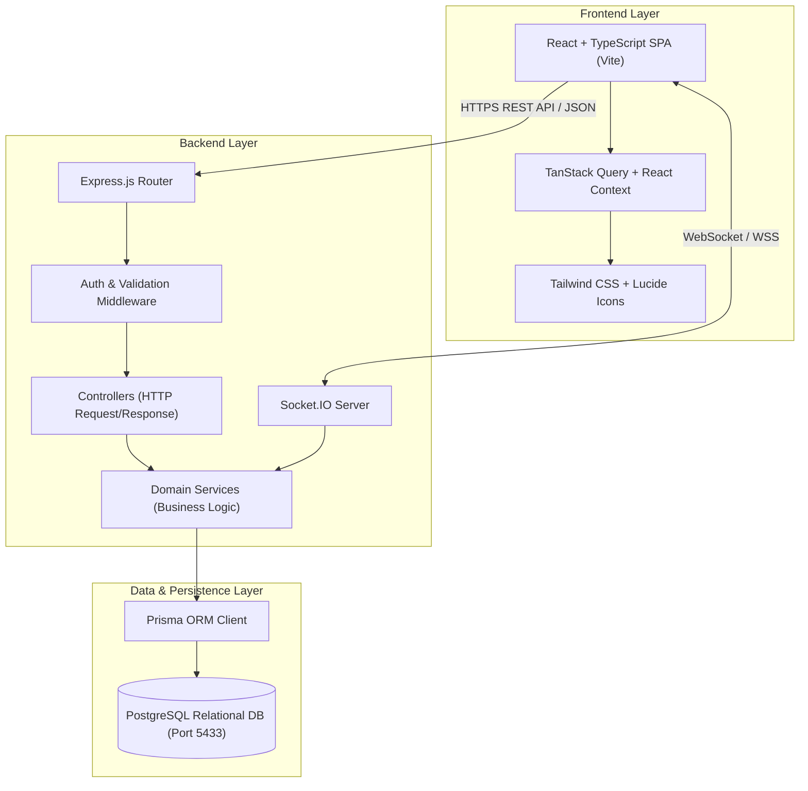

# SYNAPSE — Full-Stack Professional Networking Platform


**Synapse** is an original, production-style professional networking web platform built from scratch. Designed as a premier first-year college capstone project, Synapse pairs industry-standard full-stack architecture with clean, explainable code and three original algorithms ready for viva defense.

---

## 🚀 Key Highlights & Three Original Features

### 1. 📊 Profile Completeness Engine
- Real-time **Profile Strength %** meter analyzing 7 weighted criteria (Avatar, Headline, About, Location/Industry, Experience, Education, and Skills).
- Dynamic checklist providing one-click shortcuts to achieve **100% All-Star** status.

### 2. 🧠 Skill-Based Network Discovery
- Discovers "People You May Know" using the **Jaccard Similarity Index** over technical skills:
  $$\text{Similarity}(A, B) = \frac{|S_A \cap S_B|}{|S_A \cup S_B|}$$
- Highlights shared skills pills (e.g. `React`, `Node.js`, `Docker`) and match percentages with instant connection requests.

### 3. 🎯 Professional Opportunity Matching Engine
- Matches students and professionals to internships and tech jobs using **Rule-Based Skill Overlap**:
  $$\text{Match} = \min\left(100, \left\lfloor \frac{|S_{\text{user}} \cap R_{\text{opportunity}}|}{|R_{\text{opportunity}}|} \times 100 \right\rfloor \right)$$
- Visualizes **Matching Skills** (green) vs **Skills to Acquire** (dashed outline) with direct profile application.

---

## 📐 System Architecture

Synapse strictly separates concerns through a layered RESTful and real-time WebSocket architecture:



---

## 🛠️ Technology Stack

| Layer | Technologies | Rationale |
| :--- | :--- | :--- |
| **Frontend** | React 18, Vite, TypeScript, Tailwind CSS, TanStack Query, React Router, Lucide | High-performance SPA with client-side caching and responsive styling |
| **Backend** | Node.js, Express.js, TypeScript | Non-blocking event loop, clean layered architecture |
| **Database** | PostgreSQL 18, Prisma ORM | Strongly typed relational schema, ACID transactions, foreign key cascades |
| **Real-Time** | Socket.IO | Persistent messaging, live presence, and instant notification pushes |
| **Security** | JWT in HTTP-Only Cookies, Argon2/Bcrypt, Zod | XSS immunity, salt-hashed passwords, and strict schema validation |
| **Docs & Tests** | Swagger / OpenAPI 3.0, Vitest, Supertest | Interactive API explorer and 21 automated integration tests |

---

## 🏁 Quickstart Guide

### 1. Prerequisites
- Node.js `v18.x` or `v20.x+`
- npm `v9.x+`

### 2. Clone & Install
```bash
# Clone the repository
git clone https://github.com/yourusername/Linkedin_Clone.git
cd Linkedin_Clone

# Install dependencies for root, client, and server
npm run install:all
```

### 3. Database Initialization & Seeding
Includes an embedded PostgreSQL runner that boots automatically on port `5433`. No manual PostgreSQL installation or Docker required!
```bash
# Initialize database, run migrations, and seed demo accounts
npm run db:setup
```
*This script starts PostgreSQL, runs Prisma migrations, and seeds 21 realistic Indian tech professionals, 77 connections, 19 posts with reactions/comments, 5 groups, 6 job opportunities, and real-time chat histories.*

### 4. Start the Application
Run both backend API and frontend client with a single command:
```bash
npm run dev
```
- **Web Application**: `http://localhost:5173`
- **API Server**: `http://localhost:5000`
- **Interactive Swagger Docs**: `http://localhost:5000/api-docs`

---

## 👥 Demo Test Accounts

All demo accounts share the same password: **`Password123!`**  
See [DEMO_CREDENTIALS.md](file:///c:/Users/User/Desktop/Linkedin_Clone/DEMO_CREDENTIALS.md) for the full directory of 21 tech profiles.

| Email | Password | Persona & Focus |
| :--- | :--- | :--- |
| `aarav.sharma@example.com` | `Password123!` | Principal Architect at Swiggy (Bengaluru) · Go · Kafka · High Scale |
| `priya.patel@example.com` | `Password123!` | Staff Frontend Engineer at CRED (Mumbai) · React · TypeScript · Design Systems |
| `rohan.verma@example.com` | `Password123!` | Staff AI/ML Engineer at Microsoft IDC (Hyderabad) · Generative AI |
| `ananya.iyer@example.com` | `Password123!` | Cloud Security Lead at PhonePe (Pune) · DevSecOps · FinTech |
| `rhea.chawla@example.com` | `Password123!` | Director of Talent Acquisition at MakeMyTrip (Delhi NCR) · Hiring |

---

## 🧪 Automated Testing

Run the full integration test suite with Vitest:
```bash
cd server
npm test
```
**Test Coverage (21 Integration Tests Passing)**:
- User registration & duplicate email handling
- Password regex security enforcement
- JWT authentication & HTTP-only cookies
- Post CRUD & author authorization
- Scalable reactions toggle logic (`LIKE`, `CELEBRATE`, `LOVE`, etc.)
- Threaded comments & nested replies
- Connection state transitions (`PENDING`, `ACCEPTED`, `REJECTED`)
- Deterministic feed-ranking calculation
- Jaccard skill similarity & opportunity matching

---

## 📁 Repository Structure

```
Linkedin_Clone/
├── client/                      # React Frontend Application
│   ├── src/
│   │   ├── api/                 # Axios HTTP client & API service modules
│   │   ├── components/
│   │   │   ├── common/          # Navbar, Footer, Modal, Button, Avatar, Badges
│   │   │   ├── feed/            # PostCard, CreatePostCard, ReactionPicker, Comments
│   │   │   ├── messaging/       # ConversationList, ChatWindow
│   │   │   ├── profile/         # CompletenessCard, Edit modals
│   │   │   ├── network/         # SkillDiscoveryCard, ConnectionButton
│   │   │   └── opportunities/   # OpportunityCard
│   │   ├── contexts/            # AuthContext, SocketContext, ToastContext
│   │   ├── layouts/             # AppLayout, AuthLayout
│   │   ├── pages/               # 14 distinct functional page views
│   │   └── types/               # Full TypeScript type definitions
│   └── vite.config.ts           # Vite dev server with proxy to :5000
│
├── server/                      # Express Backend API Server
│   ├── prisma/
│   │   ├── schema.prisma        # Normalized 19-table PostgreSQL schema
│   │   └── seed.ts              # Rich seed script with 20 realistic profiles
│   ├── src/
│   │   ├── controllers/         # Request handling & HTTP status dispatch
│   │   ├── services/            # Business logic, Jaccard math & feed ranking
│   │   ├── routes/              # Express API route declarations
│   │   ├── middleware/          # Auth, Zod validation, Error handlers
│   │   ├── socket/              # Socket.IO real-time event pipeline
│   │   └── __tests__/           # Vitest integration tests
│   └── package.json
│
├── docs/                        # Complete viva & architecture documentation
│   ├── architecture.md          # System architecture & viva defense questions
│   ├── database.md              # Database ER diagram & schema reference
│   ├── api.md                   # REST API catalog & Swagger specifications
│   ├── features.md              # Features & mathematical formulas breakdown
│   └── setup.md                 # Step-by-step installation guide
│
├── README.md                    # Project master documentation
└── .env.example                 # Environment configuration template
```

---

## 📚 In-Depth Documentation

For thorough examination and viva presentation, consult the dedicated guides:
- [System Architecture & Viva Defense Guide](docs/architecture.md)
- [PostgreSQL Database & Schema Reference](docs/database.md)
- [REST API Catalog & Swagger Specs](docs/api.md)
- [Features Specification & Algorithms](docs/features.md)
- [Detailed Setup Guide](docs/setup.md)

---

## 🛡️ Security Best Practices

1. **No Plaintext Passwords**: Salted bcrypt hashing with 12 rounds.
2. **XSS Protection**: Sensitive tokens stored in secure, `HTTP-only` cookies inaccessible to JavaScript.
3. **SQL Injection Defense**: Prisma ORM with parameterized queries.
4. **Input Validation**: Centralized Zod request schemas on all mutation routes.
5. **No Secret Leaks**: Passwords and secrets are omitted from all JSON responses.
