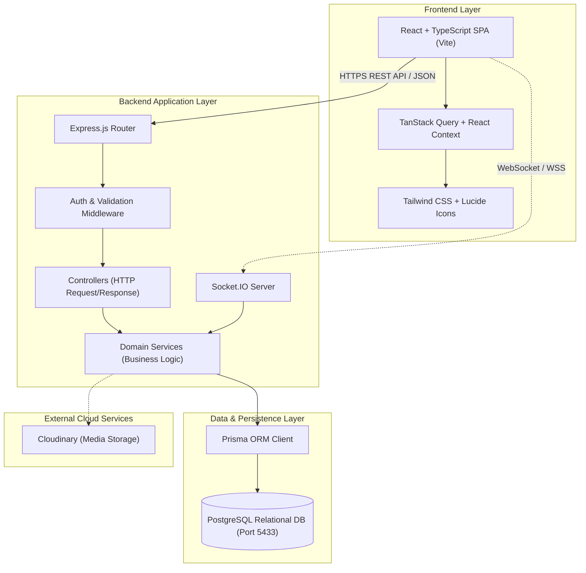
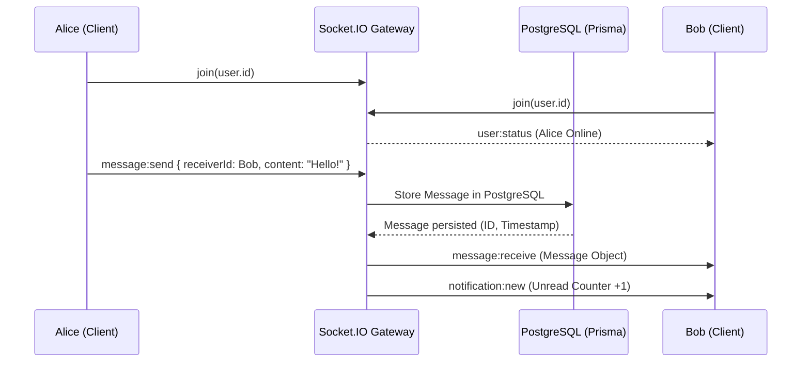

# LinkedIn Clone - System Architecture & Viva Defense Guide

This document describes the architectural design of **LinkedIn Clone**, the separation of concerns, communication protocols, and rationale behind each technology choice.

---

## 1. System Architecture Diagram



---

## 2. Layered Backend Design Pattern

The backend follows the **Separation of Concerns (SoC)** principle to ensure testability, maintainability, and clean code:

```
Request → Route → Middleware → Controller → Service → Repository (Prisma) → PostgreSQL
                                    ↓
Response ← Formatting ← JSON Data ← Output
```

1. **Routes (`server/src/routes/`)**:
   - Defines API endpoints and URL paths.
   - Attaches validation middleware and authentication guards.
   - Example: `post.routes.ts`, `connection.routes.ts`.

2. **Middleware (`server/src/middleware/`)**:
   - `auth.middleware.ts`: Verifies JWT from HTTP-only cookie or Bearer header, loads active user ID.
   - `validate.middleware.ts`: Enforces Zod schema constraints before reaching the controller.
   - `error.middleware.ts`: Catches exceptions, logs diagnostics, and returns standardized `{ success: false, message: ... }` responses without leaking stack traces.

3. **Controllers (`server/src/controllers/`)**:
   - Extracts request parameters, body, query parameters, and authenticated user ID.
   - Calls domain services and sends formatted HTTP response with appropriate status codes (`200`, `201`, `400`, `401`, `403`, `404`).

4. **Services (`server/src/services/`)**:
   - Pure business logic independent of Express `req` and `res`.
   - Performs calculations (e.g. Profile Completeness, Jaccard Skill Similarity, Deterministic Feed Scoring).
   - Manages transactions and enforces business rules (e.g., cannot connect with oneself).

5. **Prisma ORM (`server/prisma/schema.prisma`)**:
   - Type-safe query engine preventing SQL injection.
   - Generates TypeScript types directly from the PostgreSQL schema.

---

## 3. Real-Time Socket.IO Pipeline



Messages are **never** kept solely in memory. Every message is synchronously persisted in the PostgreSQL `messages` table before delivery, ensuring 100% durability if the receiver is offline.

---

## 4. Why These Technologies? (Viva Q&A Preparation)

### Q1: Why React with Vite instead of plain HTML/JS or traditional server-rendered templates?
- **Component-Driven Reusability**: Complex UI elements (like `PostCard`, `ReactionPicker`, `ProfileCard`, `CommentSection`) are encapsulated into isolated, reusable components with their own state.
- **Client-Side SPA Responsiveness**: Page transitions between Feed, Network, Profile, and Messages feel instant without full browser page reloads.
- **Vite Speed**: Uses native ES modules (ESM) during development for near-instant Hot Module Replacement (HMR) and optimized Rollup tree-shaking in production.

### Q2: Why TypeScript across both Frontend and Backend?
- **End-to-End Type Safety**: Eliminates runtime `TypeError: undefined is not an object` bugs.
- **Shared Data Models**: Interface contracts (such as `User`, `Post`, `ReactionType`, `NotificationItem`) are strictly typed between backend payloads and frontend components.
- **IDE Autocompletion & Refactoring**: Renaming a field in a model or service is caught at compile-time across the entire project.

### Q3: Why Node.js & Express?
- **Event-Driven Non-Blocking I/O**: Efficiently handles concurrent I/O operations (database queries, WebSocket real-time messaging, file uploads) on a single thread event loop.
- **Unified JavaScript/TypeScript Ecosystem**: One language across client and server reduces cognitive load and allows sharing validation schemas (Zod).
- **Express Middleware Pipeline**: Modular, battle-tested HTTP request pipeline for easy attachment of security headers, CORS, rate limiting, and auth guards.

### Q4: Why PostgreSQL instead of MongoDB? (CRITICAL VIVA TOPIC)
- **Strongly Relational Domain**: A professional network is inherently a graph of relations:
  - Users have 1:1 Profiles
  - Users have 1:N Educations, Experiences, and Skills
  - Users connect via N:M Connections with explicit state machines (`PENDING_SENT`, `CONNECTED`)
  - Posts have 1:N Comments and 1:N Reactions
- **ACID Transactions**: Relational integrity prevents orphaned comments, duplicate connection records, or invalid reaction counts.
- **Relational Integrity via Foreign Keys & Cascades**: Deleting a post automatically cleans up associated comments and reactions (`onDelete: Cascade`).
- **Data Redundancy Prevention**: MongoDB would either require duplicating user data in every post or performing complex `$lookup` aggregations that defeat document database advantages.

### Q5: Why Prisma ORM?
- **Declarative Schema**: The entire database structure, indexes, and relations are declared in one clean file (`schema.prisma`).
- **Auto-Generated Migrations**: SQL schema migrations are tracked and reproducible.
- **100% Type-Safe Queries**: Query results are statically typed. If a model changes, TypeScript immediately flags invalid property accesses.
- **Built-in SQL Injection Protection**: Prisma parameterizes all queries under the hood.

### Q6: Why JWT in HTTP-Only Cookies instead of LocalStorage?
- **Cross-Site Scripting (XSS) Immunity**: Tokens stored in `localStorage` can be stolen by malicious third-party scripts or compromised dependencies via `document.localStorage`. HTTP-Only cookies **cannot** be accessed by client-side JavaScript.
- **Automatic Browser Delivery**: The browser automatically attaches the cookie to every cross-origin request (`credentials: 'include'`).
- **CSRF Mitigations**: Protected using `SameSite=Lax` or `SameSite=Strict` cookie policies.

### Q7: Why Socket.IO instead of raw WebSockets?
- **Automatic Fallback & Heartbeats**: Socket.IO automatically downgrades to HTTP long-polling if WebSockets are blocked by proxies/firewalls and manages connection reconnection logic.
- **Rooms & Namespaces**: Simplifies direct messaging: a user simply joins room `user.id`, and private messages are emitted to that room directly with `socket.to(recipientId).emit(...)`.
