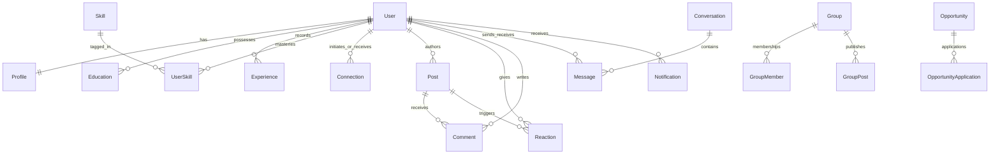

# LinkedIn Clone - PostgreSQL Database Design & Schema Reference

LinkedIn Clone utilizes **PostgreSQL** with **Prisma ORM** to enforce relational consistency, strict typing, and foreign-key referential integrity across 19 interconnected models.

---

## 1. Entity Relationship (ER) Diagram

---

## 2. Core Entities & Cardinality

### User & Profile (1:1)
- `User`: Primary identity table storing `email`, `password` (Argon2/bcrypt hash), `fullName`, `createdAt`, `updatedAt`.
- `Profile`: Extended public information including `headline`, `about`, `location`, `industry`, `avatarUrl`, `bannerUrl`, `portfolioUrl`, `githubUrl`, `linkedinUrl`.
- **Constraint**: `userId` has a `@unique` constraint with `onDelete: Cascade`.

### Education & Experience (1:N)
- `Education`: `institution`, `degree`, `fieldOfStudy`, `startYear`, `endYear`, `grade`, `activities`.
- `Experience`: `company`, `position`, `location`, `startDate`, `endDate`, `isCurrent`, `description`.
- Both link to `User` via foreign key `userId` with cascade deletion.

### Skills & UserSkill (N:M through join table)
- `Skill`: Normalized canonical dictionary of skills (`name`, `category`).
- `UserSkill`: Join table linking `userId` + `skillId`, with `level` (`BEGINNER`, `INTERMEDIATE`, `ADVANCED`, `EXPERT`) and `endorsementsCount`.
- **Unique Constraint**: `@@unique([userId, skillId])` guarantees a user cannot add the same skill twice.

### Connections (Self-Referential Graph)
- `Connection`:
  - `requesterId`: User who initiated the invitation.
  - `recipientId`: Target user.
  - `status`: Enum (`PENDING`, `ACCEPTED`, `REJECTED`).
- **Unique Constraint**: `@@unique([requesterId, recipientId])` ensures only one active relation exists per direction.
- **Business Logic Constraint**: Validated in service to prevent `requesterId === recipientId`.

### Posts, Reactions & Comments (Social Graph)
- `Post`: `authorId`, `content`, `imageUrl`, `linkUrl`, `tags`, `isPublic`.
- `Reaction`:
  - `type`: Enum (`LIKE`, `CELEBRATE`, `SUPPORT`, `LOVE`, `INSIGHTFUL`).
  - **Unique Constraint**: `@@unique([userId, postId])` ensures a user can only have **one** active reaction per post. Toggling the same reaction removes it; choosing another updates the reaction type in place.
- `Comment`: Supports recursive threaded replies via optional `parentId` pointing to another `Comment`.
  - Self-relation: `Comment` (parent) `1:N` `Comment` (replies).
  - Cascade rules ensure removing a parent comment cleanly purges replies.

### Real-Time Messaging
- `Conversation`: Tracks conversation threads between two participants (`user1Id`, `user2Id`).
  - **Unique Constraint**: `@@unique([user1Id, user2Id])` prevents duplicate chat threads between the same two users.
- `Message`: Stores `conversationId`, `senderId`, `content`, `isRead`, `createdAt`.
  - Indexed by `[conversationId, createdAt]` for fast paginated chat rendering.

### Groups & Communities
- `Group`: `name`, `slug` (unique), `description`, `category`, `imageUrl`, `creatorId`.
- `GroupMember`: Links `userId` + `groupId`, with `role` (`ADMIN`, `MODERATOR`, `MEMBER`).
- `GroupPost`: Group-scoped posts with comments and discussions.

### Professional Opportunities
- `Opportunity`: `title`, `company`, `type` (`FULL_TIME`, `PART_TIME`, `INTERNSHIP`, `CONTRACT`), `location`, `workplaceType` (`REMOTE`, `HYBRID`, `ON_SITE`), `requiredSkills` (string array), `experienceLevel`.
- `OpportunityApplication`: Links `userId` + `opportunityId` with `status` (`APPLIED`, `UNDER_REVIEW`, `ACCEPTED`, `REJECTED`).

---

## 3. Indexing Strategy

To maintain sub-50ms query times at scale, the database contains targeted B-Tree indexes:

| Table | Index Columns | Purpose |
| :--- | :--- | :--- |
| `posts` | `[createdAt(sort: Desc)]` | Fast global and connection feed retrieval |
| `posts` | `[authorId]` | Loading author profile activity posts |
| `reactions` | `[postId, type]` | Quick aggregation of reaction counts by reaction type |
| `comments` | `[postId, parentId]` | Fetching top-level comments and nested reply trees |
| `messages` | `[conversationId, createdAt]` | Chronological paginated chat history |
| `notifications` | `[recipientId, isRead]` | Unread notification badge count and notifications feed |
| `connections` | `[requesterId, status]` & `[recipientId, status]` | Fast lookup of connection status and network lists |
| `groups` | `[slug]` | Instant SEO-friendly URL lookups (`/groups/:slug`) |
